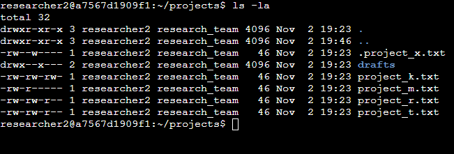
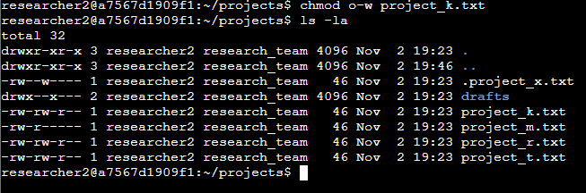
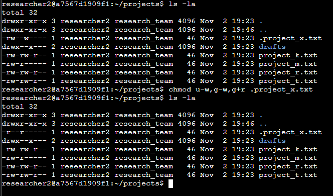
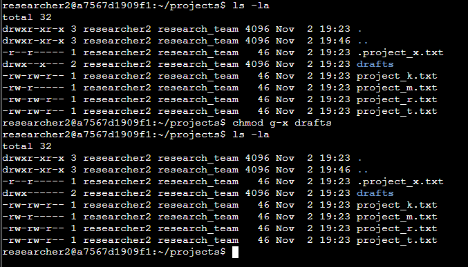

# File Permissions in Linux

> **Google Cybersecurity Certificate lab.** This is a simulated scenario completed in a course lab environment, not production work.

## Scenario
In this lab, I acted as a security professional supporting a research team. I audited the permissions in `/home/researcher2/projects` and used Linux commands to remove access that the team's authorization policy did not allow.

## My Role
- Checked every file and directory, including hidden ones, with `ls -la`
- Read the 10-character permission strings to find access that broke policy
- Corrected the permissions with `chmod`, applying least privilege

## What I Changed
| Item | Before | After | Command | Why |
|---|---|---|---|---|
| `project_k.txt` | `-rw-rw-rw-` | `-rw-rw-r--` | `chmod o-w project_k.txt` | Other may not write to any file |
| `.project_x.txt` (hidden, archived) | `-rw--w----` | `-r--r-----` | `chmod u-w,g-w,g+r .project_x.txt` | No one writes; user and group can read |
| `drafts/` | `drwx--x---` | `drwx------` | `chmod g-x drafts` | Only researcher2 may enter the directory |

## Screenshots
**1. Checking permissions, including hidden files**

**2. Removing write access for other**

**3. Locking down the hidden archived file**

**4. Restricting the drafts directory**

## Skills
Linux command line, file permissions, `chmod`, `ls -la`, hidden files, least privilege, authorization auditing

## Full Write-up
[File-permissions-in-Linux.pdf](File-permissions-in-Linux.pdf)
